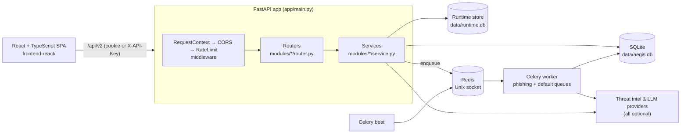
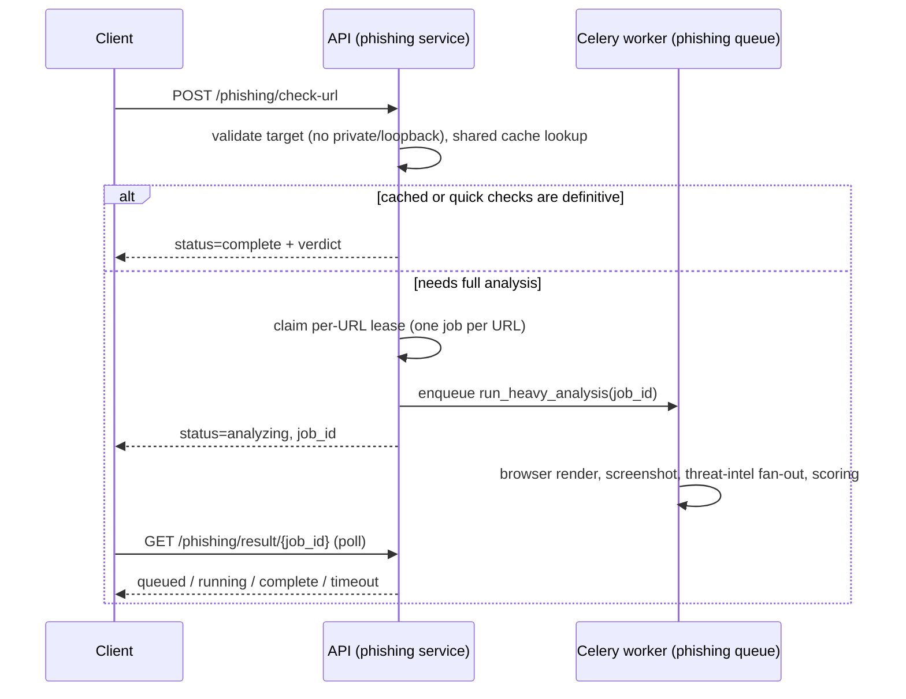

# Architecture

AegisNexus runs as a single deployable unit on one machine: an API process, a Celery worker and Celery beat, which share a SQLite database and a private Redis instance. `./run.sh` (`scripts/run_local.py`) supervises all of them.



## Layout

```
app/                 platform core
  main.py            create_app(): middleware, routers, error handlers, SPA
  config.py          typed Settings, the only place that reads the environment
  auth.py            API key / session → APIKey principal; role dependencies
  errors.py          error envelope and AppError hierarchy for services
  observability.py   logging setup, X-Request-ID, access log
  database.py        engine, session factory, DeclarativeBase
  models.py          SQLAlchemy 2.0 typed models
  migrations.py      Alembic helpers (head check, upgrade/stamp)
  celery_app.py      Celery app, queues and beat schedule
  workflow_tasks.py  outbox delivery, watchlist checks, report PDFs, credential purge
  routers/           auth, admin, reports, workspace
  discovery/         phishing discovery crawler (router, service, worker, CertStream)
modules/             security modules: router.py (HTTP), service.py (use cases), schemas.py (I/O models)
  phishing_detector/ scanner, threat-intel aggregation, screenshot/visual analysis, feeds
  honeypot/          decoy, IOC collector, IOC API and STIX export
  ai_analyzer/       hybrid message analysis, incident-report analysis
  sms_guard/         SMS rules + IOC cross-check
  shared/            in-process event bus and listeners
alembic/versions/    schema history, the only schema authority
frontend-react/      Vite + React 19 + TypeScript SPA
tests/               pytest suite (unit, API contract, migrations, workflows)
```

## Layering

Each module follows the same split:

- **`router.py`** handles HTTP only: parameter validation (`Query(ge=…, le=…)`, Pydantic bodies), auth dependencies and response models. It holds no SQL and no business rules.
- **`service.py`** holds the use cases. Services take a `Session` and plain values and return plain data. They raise `app.errors.AppError` subclasses (`NotFound`, `Conflict`, `Unprocessable`, `ServiceUnavailable`, …), which the app maps to the standard error envelope. This keeps services free of HTTP imports and testable on their own.
- **`schemas.py`** holds request and response models. Where a payload is produced by a scorer and evolves with it (for example scan verdicts), the endpoint documents it instead of pinning it in a model.

## Request lifecycle

1. `RequestContextMiddleware` accepts or creates `X-Request-ID`, binds it to every log record, writes one access-log line (method, path, status, duration, never the query string) and turns unhandled exceptions into a `500` envelope.
2. `CORSMiddleware`.
3. `RateLimitMiddleware` applies a per-IP cap and per-user/role budgets for mutating requests. It also blocks cross-origin cookie-authenticated writes (CSRF).
4. The router dependencies `resolve_api_key`, `resolve_optional_api_key` or `require_role(...)` resolve the principal.
5. The service runs. Errors become `{detail, error: {code, status, request_id}}`.

## URL scan flow



Signed-in callers get a private copy of each verdict in their history (`PrivateScan`). Anonymous scans are not attributed.

## Background work

| Beat entry | Task | Purpose |
|---|---|---|
| every 10 s | `app.discovery.tasks.tick` | discovery crawler step |
| every 30 s | `app.workflow_tasks.deliver_outbox` | durable event delivery (transactional outbox) |
| hourly | `app.workflow_tasks.check_watchlist` | notify users when a watched domain's IOC status changes |
| hourly | honeypot feed refresh | URLhaus / PhishTank / OTX IOCs and phishing feeds |
| every 6 h | PhishTank DB sync | refresh the local PhishTank copy |
| daily | Spamhaus, ThreatFox, credential purge | enrichment and housekeeping |
| weekly | IP blacklist refresh | AbuseIPDB-style IP lists |

Tasks are idempotent and use leases in the runtime store, so overlapping runs and multiple workers are safe. `acks_late` together with `task_reject_on_worker_lost` redelivers work after a crash.

## Data

- `data/aegis.db` is the application database (users, keys, reports, IOCs, phishing URLs, crawler state). SQLite runs in WAL mode with foreign keys on.
- `data/runtime.db` holds short-lived coordination data: rate-limit counters, job state, leases and the AI call budget. It can be deleted at any time.
- **Migrations:** Alembic is authoritative. The API never creates tables. `/ready` returns 503 until the schema is at head. A test compares the models with `alembic upgrade head`.

## Security model (summary)

- API keys and session/recovery tokens are random 256-bit values, stored only as SHA-256 hashes.
- One role-based authorization model. Admins are created with `make create-admin`. No shared admin secret exists.
- Outbound requests made on a user's behalf go through `app/outbound.py`. It resolves the target and rejects private, loopback and reserved addresses on every redirect (SSRF protection).
- Error responses never include exception text. Correlate failures through `request_id`.

See [SECURITY.md](SECURITY.md).

## Design decisions

- **SQLite + local Redis instead of Postgres/RabbitMQ.** The target is a single self-hosted machine with no Docker. WAL mode and short transactions are enough for the write volume, and the Redis Unix socket keeps the broker off the network.
- **Transactional outbox for cross-module events.** Modules publish `url.phishing_confirmed`, `honeypot.ioc_collected` and `report.pdf_requested` in the same transaction as their data. A periodic task delivers them, so no event is lost when a process dies.
- **Human-in-the-loop discovery.** The crawler only suggests candidates. Nothing reaches the phishing database without an operator confirming a fresh (≤48 h), complete, live observation.
